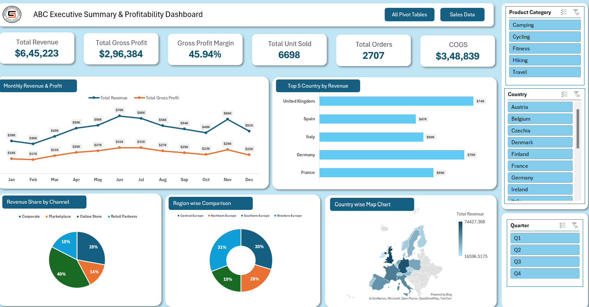

# Excel Sales Dashboard

An interactive Excel dashboard designed to analyze sales performance, revenue trends, profitability, and regional and channel-wise performance.

## Dashboard Preview

## Project Overview

This project uses Microsoft Excel to transform sales transaction data into an interactive dashboard for business performance monitoring and analysis.

The workbook contains three sheets:

- **Dashboard:** Visual representation of key performance indicators and sales analysis.
- **Pivot Tables:** Summarized data supporting the dashboard visualizations.
- **Data:** Underlying sales transaction records.

## Key Performance Indicators

The dashboard tracks the following metrics:

| KPI | Description |
|---|---|
| Total Revenue | Total revenue generated from sales |
| Total Gross Profit | Revenue remaining after cost of goods sold |
| Gross Profit Margin | Gross profit as a percentage of revenue |
| Units Sold | Total quantity of products sold |
| Total Orders | Count of order records |
| Cost of Goods Sold (COGS) | Cost associated with the products sold |

## Dashboard Analysis

### 1. Monthly Sales Performance
Analyze monthly revenue and gross profit trends to identify changes in sales performance throughout the year.

### 2. Country-wise Revenue
Compare revenue across countries to identify key markets and differences in sales contribution.

### 3. Sales Channel Analysis
Evaluate revenue generated through Corporate, Marketplace, and Online Store channels.

### 4. Regional Performance
Compare revenue across geographical regions to understand their contribution to overall sales.

## Tools and Techniques

- Microsoft Excel
- Pivot Tables
- Excel Charts
- KPI Reporting
- Sales and Profitability Analysis

## Business Objectives

- Monitor overall sales performance.
- Track revenue and profitability.
- Identify high-performing countries and regions.
- Compare sales channels.
- Support data-driven business decisions.

## How to Use

1. Download `Excel_Sales_Dashboard.xlsx` from this repository.
2. Open the workbook in Microsoft Excel.
3. Navigate to the **Dashboard** sheet to view the dashboard.
4. Explore the **Pivot Tables** sheet to review summarized data.
5. Visit the **Data** sheet to inspect the underlying sales records.

## Project Files

- `Excel_Sales_Dashboard.xlsx` — Complete Excel workbook.
- `images/sales-dashboard.png` — Dashboard preview.
- `README.md` — Project documentation.

---

*This project demonstrates the use of Excel for sales reporting, KPI monitoring, and business performance analysis.*
